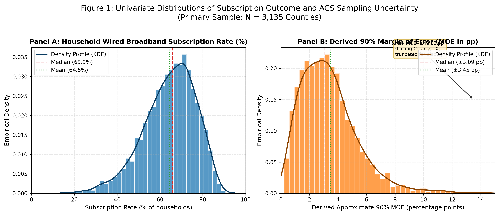
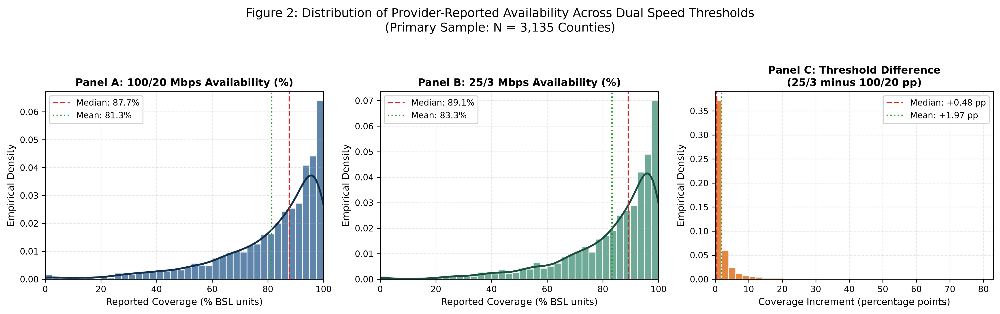
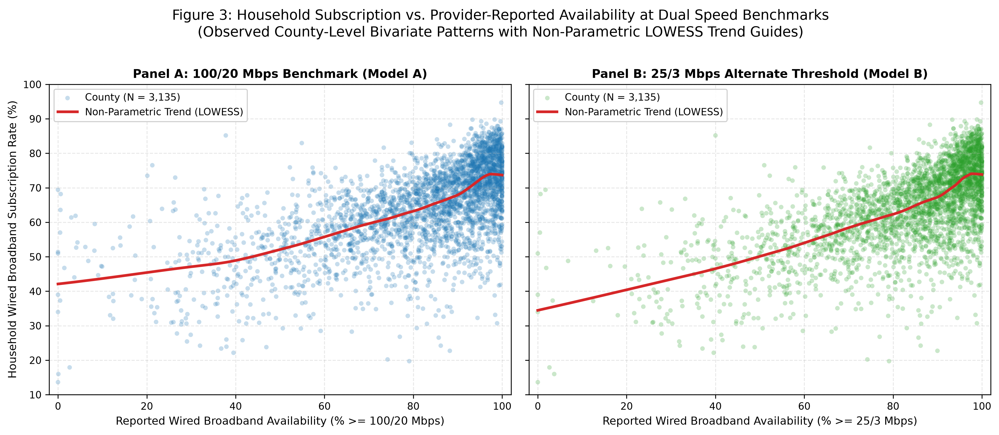
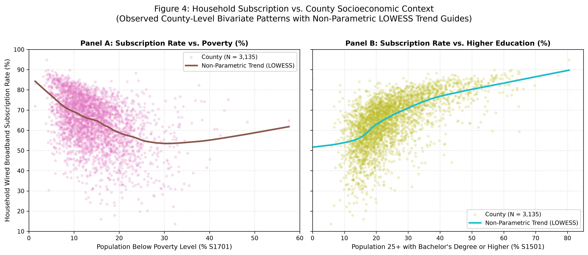
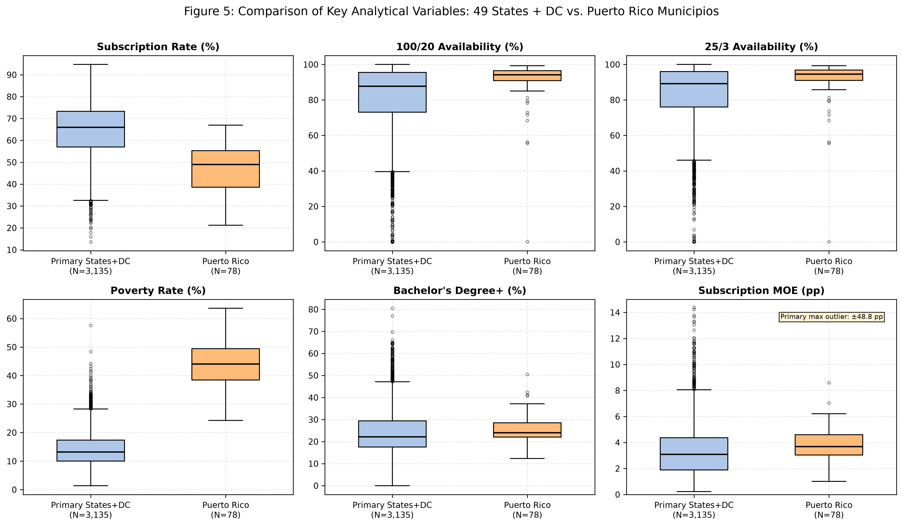

# Descriptive and Exploratory Analysis: County Broadband Availability and Household Subscription

**Phase:** Phase 4B — Step 1: Prepare the Analysis Dataset and Exploratory Results 
**Repository:** `nayanojwal0810/BroadBand` 
**Generated:** 2026-10-18 15:54:46 UTC 
**Status:** Descriptive & Exploratory Analysis Complete (Governance Compliant)

---

## 1. Executive Summary & Governance Compliance

This report presents the descriptive statistics and exploratory data visualizations for the analysis-ready county dataset created from the validated FCC Broadband Data Collection (BDC) and U.S. Census Bureau American Community Survey (ACS) 5-Year inputs.

### Strict Methodological Governance Notice
In accordance with Gate Zero, Phase 3, Phase 4A, and Phase 4B project directives:
1. **No Regression Estimation:** No Ordinary Least Squares (OLS), Weighted Least Squares (WLS), or multivariable regression models have been fitted.
2. **No Correlation Quantification:** No Pearson product-moment ($r$), Spearman rank ($
ho$), or related bivariate correlation coefficients have been calculated or reported.
3. **No P-Values or Model Metrics:** No statistical hypothesis testing, $p$-values, $R^2$, or goodness-of-fit metrics are evaluated.
4. **No Causal or Ecological Claims:** County-level aggregates are presented purely as observational ecological patterns. They do not measure individual household decision-making, and differences between aggregate provider availability and aggregate household subscription are not characterized as an individual "availability–adoption gap."
5. **No Empirical Sensitivity Determinations:** This report does not claim to have measured the empirical sensitivity of the availability–subscription relationship; that determination is reserved for the pre-specified multivariable model comparisons.
6. **Deferred Secondary Methods Maintained:** Both the moment-matched Beta Monte Carlo simulation and the wild cluster bootstrap remain explicitly marked as deferred secondary methods. Neither method was executed in this step.

---

## 2. Dataset Construction and Geographic Sample Definitions

The analysis dataset was constructed by `scripts/prepare_analysis_dataset.py` using **exact 5-digit FIPS code matching** across all four raw source files in `data/raw/`. The resulting processed dataset is stored at:
- `data/processed/county_broadband_analysis.csv` ($N = 3,213$ rows, 25 columns)
- Audit Report: `reports/analysis_dataset_validation.json` (`dataset_validation_status: "PASS"`)

### Sample Partitioning
- **Primary Study Sample ($N = 3,135$ counties, `is_primary_sample = 1`):**
  - Covers 49 U.S. states plus Washington, DC.
  - Excludes Connecticut (`09`): Exactly 0 FIPS codes match because Census transitioned to 9 Planning Regions (`09110`–`09190`) while FCC retains 8 legacy county codes (`09001`–`09015`). No ad hoc crosswalk is created.
  - Excludes Puerto Rico (`72`): Held out for independent sensitivity analysis.
  - Excludes Island Territories: ACS detailed/subject tables are not published for American Samoa, Guam, Northern Mariana Islands, and U.S. Virgin Islands.
- **Puerto Rico Sensitivity Sample ($N = 3,213$ counties, `is_pr_inclusive_sample = 1`):**
  - Includes all 3,135 primary counties plus the 78 matching Puerto Rico municipios (`72001`–`72153`).
- **Missingness and Imputation:** Exactly zero missing values exist across all required analytical fields. No zero imputation or synthetic values were applied.

---

## 3. Comprehensive Descriptive Statistics

Below are non-parametric and parametric descriptive summaries across all analytical variables for the primary study sample ($N = 3,135$), Puerto Rico sensitivity sample ($N = 78$), and the combined national dataset ($N = 3,213$).

### Table 1: Primary Sample Descriptive Statistics ($N = 3,135$ Counties: 49 States + DC)

| Variable | Field Name | N | Missing | Mean | Std Dev | Min | Q1 (25%) | Median | Q3 (75%) | Max | IQR |
| :--- | :--- | :---: | :---: | :---: | :---: | :---: | :---: | :---: | :---: | :---: | :---: |
| **Wired Subscription Rate (%)** | `subscription_rate_pct` | 3,135 | 0 | 64.50% | 12.14% | 13.62% | 56.98% | 65.93% | 73.27% | 94.71% | 16.29% |
| **FCC 100/20 Availability (%)** | `avail_100_20_pct` | 3,135 | 0 | 81.32% | 19.18% | 0.00% | 73.14% | 87.69% | 95.48% | 100.00% | 22.34% |
| **FCC 25/3 Availability (%)** | `avail_25_3_pct` | 3,135 | 0 | 83.30% | 17.32% | 0.00% | 75.97% | 89.13% | 96.00% | 100.00% | 20.03% |
| **Coverage Increment (25/3 - 100/20 pp)** | `coverage_diff_pct` | 3,135 | 0 | +1.97 pp | 4.54 pp | 0.00 pp | +0.02 pp | +0.48 pp | +1.99 pp | +81.01 pp | 1.97 pp |
| **Poverty Percentage (%)** | `poverty_pct` | 3,135 | 0 | 14.24% | 5.95% | 1.40% | 10.00% | 13.20% | 17.35% | 57.60% | 7.35% |
| **Bachelor's Degree or Higher (%)** | `bachelor_plus_pct` | 3,135 | 0 | 24.64% | 10.26% | 0.00% | 17.50% | 22.10% | 29.45% | 80.50% | 11.95% |
| **Subscription Rate MOE (pp)** | `subscription_rate_moe_pp` | 3,135 | 0 | ±3.45 pp | 2.49 pp | ±0.23 pp | ±1.90 pp | ±3.09 pp | ±4.36 pp | ±48.82 pp | 2.46 pp |

### Table 2: Puerto Rico Municipios Descriptive Statistics ($N = 78$ Municipios)

| Variable | Field Name | N | Missing | Mean | Std Dev | Min | Q1 (25%) | Median | Q3 (75%) | Max | IQR |
| :--- | :--- | :---: | :---: | :---: | :---: | :---: | :---: | :---: | :---: | :---: | :---: |
| **Wired Subscription Rate (%)** | `subscription_rate_pct` | 78 | 0 | 46.62% | 11.35% | 21.18% | 38.63% | 49.03% | 55.27% | 66.93% | 16.63% |
| **FCC 100/20 Availability (%)** | `avail_100_20_pct` | 78 | 0 | 90.43% | 13.35% | 0.07% | 90.85% | 94.21% | 96.53% | 99.24% | 5.68% |
| **FCC 25/3 Availability (%)** | `avail_25_3_pct` | 78 | 0 | 90.71% | 13.37% | 0.07% | 91.00% | 94.53% | 96.90% | 99.25% | 5.90% |
| **Coverage Increment (25/3 - 100/20 pp)** | `coverage_diff_pct` | 78 | 0 | +0.27 pp | 0.51 pp | 0.00 pp | +0.00 pp | +0.04 pp | +0.39 pp | +2.61 pp | 0.39 pp |
| **Poverty Percentage (%)** | `poverty_pct` | 78 | 0 | 43.68% | 8.28% | 24.30% | 38.48% | 44.05% | 49.45% | 63.60% | 10.98% |
| **Bachelor's Degree or Higher (%)** | `bachelor_plus_pct` | 78 | 0 | 25.28% | 6.62% | 12.30% | 22.00% | 24.05% | 28.48% | 50.50% | 6.48% |
| **Subscription Rate MOE (pp)** | `subscription_rate_moe_pp` | 78 | 0 | ±3.76 pp | 1.34 pp | ±1.00 pp | ±3.04 pp | ±3.68 pp | ±4.59 pp | ±8.60 pp | 1.56 pp |

### Table 3: Combined Puerto Rico-Inclusive Sample ($N = 3,213$ Records)

| Variable | Field Name | N | Missing | Mean | Std Dev | Min | Q1 (25%) | Median | Q3 (75%) | Max | IQR |
| :--- | :--- | :---: | :---: | :---: | :---: | :---: | :---: | :---: | :---: | :---: | :---: |
| **Wired Subscription Rate (%)** | `subscription_rate_pct` | 3,213 | 0 | 64.07% | 12.43% | 13.62% | 56.34% | 65.56% | 73.09% | 94.71% | 16.75% |
| **FCC 100/20 Availability (%)** | `avail_100_20_pct` | 3,213 | 0 | 81.54% | 19.11% | 0.00% | 73.36% | 88.00% | 95.51% | 100.00% | 22.14% |
| **FCC 25/3 Availability (%)** | `avail_25_3_pct` | 3,213 | 0 | 83.48% | 17.27% | 0.00% | 76.47% | 89.37% | 96.03% | 100.00% | 19.56% |
| **Coverage Increment (25/3 - 100/20 pp)** | `coverage_diff_pct` | 3,213 | 0 | +1.93 pp | 4.49 pp | 0.00 pp | +0.02 pp | +0.46 pp | +1.93 pp | +81.01 pp | 1.90 pp |
| **Poverty Percentage (%)** | `poverty_pct` | 3,213 | 0 | 14.96% | 7.53% | 1.40% | 10.10% | 13.40% | 17.80% | 63.60% | 7.70% |
| **Bachelor's Degree or Higher (%)** | `bachelor_plus_pct` | 3,213 | 0 | 24.66% | 10.19% | 0.00% | 17.60% | 22.20% | 29.40% | 80.50% | 11.80% |
| **Subscription Rate MOE (pp)** | `subscription_rate_moe_pp` | 3,213 | 0 | ±3.45 pp | 2.47 pp | ±0.23 pp | ±1.92 pp | ±3.11 pp | ±4.37 pp | ±48.82 pp | 2.45 pp |

---

## 4. Visual Exploratory Analysis

### Figure 1: Distributions of Subscription Rate and Approximate Sampling Uncertainty

#### Descriptive Observations
1. **Household Wired Broadband Subscription Rate (Panel A):**
   - The primary sample distribution of county-level subscription rates is unimodal and approximately symmetric, centered at a median of **65.9%** (mean: **64.5%**).
   - The central 50% of counties (interquartile range) span from **57.0%** to **73.3%** (IQR = 16.3 percentage points).
   - Substantial county-level variation is evident across the country, spanning from a minimum of **13.6%** (Crowley County, CO: `08025`) to a maximum of **94.7%** (Falls Church city, VA: `51610`).
2. **ACS Derived Margin of Error (Panel B):**
   - The derived 90% margin of error (MOE) in percentage points is heavily right-skewed.
   - For the typical county, sampling error is moderate: the median MOE is **±3.09 pp** and the 75th percentile is **±4.36 pp**.
   - However, a long right tail of small-population rural counties exhibits substantial survey uncertainty. The maximum observed uncertainty occurs in Loving County, TX (`48301`), with a derived MOE of **±48.82 pp** (estimated total households: 27).

---

### Figure 2: Availability Distributions Across Speed Thresholds and Difference

#### Descriptive Observations
1. **FCC 100/20 Mbps Baseline Availability (Panel A):**
   - County-level provider-reported wired availability at $\ge 100/20$ Mbps is heavily concentrated near universal deployment, with a median of **87.7%** and a mean of **81.3%**.
   - Over 25% of counties report availability exceeding **95.5%**, and 70 counties report exactly 100.0% coverage.
   - A pronounced left tail of underserved rural counties exists, with 5 counties reporting 0.0% coverage at this threshold.
2. **FCC 25/3 Mbps Alternate Threshold Availability (Panel B):**
   - Lowering the speed threshold to $\ge 25/3$ Mbps shifts the distribution modestly to the right, yielding a median coverage of **89.1%** (mean: **83.3%**).
   - Exactly 73 counties report 100.0% availability at 25/3 Mbps.
3. **Threshold Difference (25/3 minus 100/20 Mbps, Panel C):**
   - The coverage difference (`coverage_diff_pct = avail_25_3_pct - avail_100_20_pct`) satisfies exact weak monotonicity across all 3,135 primary counties (min = 0.00 pp, 0 violations).
   - For the vast majority of counties, the difference between the two thresholds is small: the median difference is only **+0.48 pp** (mean: **+1.97 pp**).
   - However, in specific rural jurisdictions, legacy wired technologies (e.g., standard DSL) provide coverage meeting 25/3 Mbps but falling short of 100/20 Mbps, producing increments up to **+81.01 pp**.

---

### Figure 3: Subscription vs. Availability at Dual Speed Thresholds

#### Descriptive Observations
1. **Bivariate Visual Patterns:**
   - Both panels display a clear positive non-parametric relationship (indicated by the red LOWESS smoother) between provider-reported availability and household-reported subscription rates.
   - At low levels of reported availability (< 40%), subscription rates are generally lower, averaging around 30% to 50%.
   - As availability rises above 80%, subscription rates rise steadily, but exhibit substantial vertical dispersion: among counties with near 100% reported availability, household subscription rates vary widely from ~40% to >90%.
2. **Comparison Across Thresholds:**
   - The overall shape of the scatter and LOWESS curve is visually similar between the 100/20 Mbps baseline (Panel A) and the 25/3 Mbps alternate threshold (Panel B).
   - In Panel B, observations in the left tail are shifted slightly to the right due to the higher reported coverage under the legacy 25/3 definition.
   - *Cautionary Note:* While a positive visual association is apparent, whether the estimated slope or coefficient differs meaningfully between the two speed thresholds cannot be determined from scatterplots alone; this requires formal multivariable model comparisons.

---

### Figure 4: Subscription vs. County Socioeconomic Context

#### Descriptive Observations
1. **Poverty Percentage (Panel A):**
   - A pronounced negative bivariate visual pattern is observed between county poverty rates and household wired broadband subscription rates.
   - Counties with low poverty rates (< 10%) frequently exhibit subscription rates exceeding 70% to 80%.
   - As poverty increases toward 30% and above, subscription rates decline noticeably, with the LOWESS trend guide sloping downward across the entire support.
2. **Educational Attainment (Panel B):**
   - A strong positive bivariate visual pattern is observed between the percentage of adults holding a Bachelor's degree or higher and household wired broadband subscription.
   - Counties with higher educational attainment (> 40%) consistently display subscription rates above 75%, whereas counties with lower attainment (< 15%) cluster between 40% and 60%.
   - These patterns confirm the substantive necessity of controlling for local socioeconomic context when examining broadband availability.

---

### Figure 5: Comparative Patterns: Primary Sample vs. Puerto Rico Municipios

#### Descriptive Observations
1. **Subscription Rates:**
   - Puerto Rico municipios exhibit markedly lower household wired subscription rates (median: **49.0%**, mean: **46.6%**) compared to the 49 states + DC primary sample (median: **65.9%**, mean: **64.5%**).
2. **Reported Availability:**
   - In contrast to lower subscription, provider-reported wired availability in Puerto Rico is exceptionally high, with a median of **94.2%** for 100/20 Mbps and **94.5%** for 25/3 Mbps, substantially higher than the primary sample median of **87.7%**.
3. **Socioeconomic Disparities:**
   - Puerto Rico municipios display dramatically higher poverty rates (median: **44.0%**, range: 24.3%–63.6%) than the primary sample (median: **13.2%**, range: 1.4%–57.6%).
   - Educational attainment in Puerto Rico (median: **24.1%**) is comparable to the lower half of the primary sample distribution.
4. **Methodological Implication:**
   - The juxtaposition of high reported availability with low subscription and high poverty in Puerto Rico confirms the wisdom of treating Puerto Rico as an independent sensitivity sample rather than pooling it uncritically into the primary baseline specification.

---

## 5. Status of Deferred Secondary Methods

In accordance with Phase 4A decisions, two secondary analytical components remain deferred:

### 1. Moment-Matched Beta Monte Carlo Simulation (Deferred)
- **Feasibility Status:** Fully feasible across all 3,135 primary counties ($0 < \text{variance} < p(1-p)$).
- **Shape Diagnostics Caveat:** While 3,134 counties produce unimodal Beta distributions ($\alpha > 1, \beta > 1$), **Loving County, TX (`48301`)** exhibits $\alpha = 0.3689 < 1$ and $\beta = 0.0642 < 1$, resulting in a U-shaped density that concentrates mass at 0% and 100%.
- **Action Taken:** Execution remains deferred. No perturbation draws or simulated regressions were conducted in this step.

### 2. Wild Cluster Bootstrap (Deferred)
- **Status:** Requires cluster-robust re-sampling at the state level (50 clusters).
- **Implementation Status:** No local package (`wildboottest` or R environment) is currently installed in the workspace.
- **Action Taken:** Execution remains deferred pending technical review of the execution route.

---

## 6. Conclusion & Next Steps

This exploratory analysis completes Step 1 of Phase 4B. The analysis dataset has been assembled, verified against all pre-specified integrity criteria, and documented. The exploratory distributions and scatterplots provide a transparent, non-parametric foundation for subsequent modeling.

**Next Immediate Action:** Submit this report, the validation JSON, and generated figures for ChatGPT review. Do not fit regression models until authorized.
