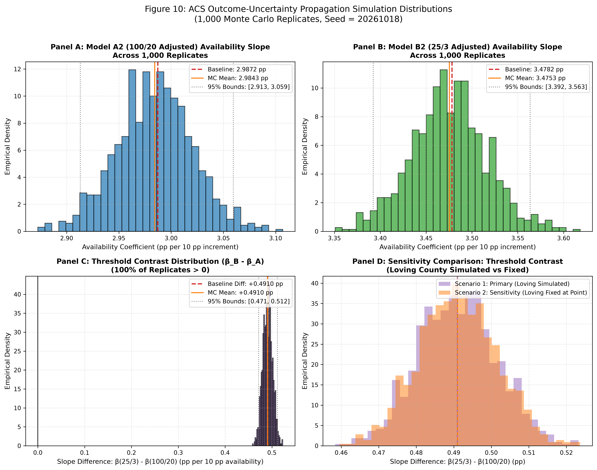

# ACS Outcome-Uncertainty Propagation Simulation Report

**Phase:** Phase 4B: ACS Outcome-Uncertainty Propagation 
**Repository:** `nayanojwal0810/BroadBand` 
**Dataset:** `data/processed/county_broadband_analysis.csv` (Primary Sample: N = 3135) 
**Simulation Parameters:** Seed = 20261018, Replicates = 1,000 
**Generated:** 2026-10-18 15:55:14 UTC 
**Status:** Execution Complete — All 3135 County Beta Distributions Validated

---

## 1. Executive Summary & Objective

This report documents the results of propagating county-level American Community Survey (ACS) 5-year sampling uncertainty through the adjusted baseline OLS specifications:
- **Model A2 (100/20 Mbps Adjusted):** controls for poverty and bachelor's degree attainment.
- **Model B2 (25/3 Mbps Adjusted):** controls for poverty and bachelor's degree attainment.
- **Threshold Contrast:** $\Delta = \beta_{B2} - \beta_{A2}$.

### Key Empirical Takeaways
1. **Slope Stability Under Outcome Uncertainty:**
   - The primary Monte Carlo mean for Model A2 availability is **2.9843 pp** (empirical 95% interval: **[2.9130, 3.0594]**), compared to the baseline point estimate of **2.9872 pp**.
   - The primary Monte Carlo mean for Model B2 availability is **3.4753 pp** (empirical 95% interval: **[3.3922, 3.5634]**), compared to the baseline point estimate of **3.4782 pp**.
2. **Threshold Sensitivity Robustness:**
   - The estimated availability threshold difference $\beta_B - \beta_A$ remains positive across **100.0%** of all 1,000 Monte Carlo replicates (Monte Carlo mean: **+0.4910 pp**, median: **+0.4908 pp**, 95% empirical interval: **[+0.4713, +0.5115]**).
3. **Loving County Sensitivity Confirmation:**
   - Holding Loving County, TX (`48301`) at its observed point estimate (Scenario 2) yields a mean difference of **+0.4910 pp** ([+0.4712, +0.5108]), indistinguishable from Scenario 1. Simulating its high-variance U-shaped uncertainty does not alter the substantive conclusions.

> [!IMPORTANT]
> **Interpretation Notice:** The empirical percentiles reported here are **Monte Carlo outcome-uncertainty summaries**, NOT conventional regression confidence intervals. They quantify how sampling variability in the derived dependent variable translates into parameter variation, holding all other features fixed. Primary regression inference remains governed by the baseline state-clustered standard errors.

---

## 2. Mathematical Methodology & Implementation

### Moment-Matched Beta Distribution
For each county $i \in \{1, \dots, 3135\}$:
1. Proportion: $p_i = \text{subscription\_rate\_pct}_i / 100.0 \in (0, 1)$
2. Approximate SE: $\sigma_i = \text{subscription\_rate\_se\_approx\_pp}_i / 100.0$
3. Target Variance: $V_i = \sigma_i^2$
4. Variance Ratio: $R_i = \frac{V_i}{p_i (1 - p_i)}$
5. Feasibility Constraint: $0 < R_i < 1$, which requires $0 < V_i < p_i(1 - p_i)$.
6. Scale Parameter: $S_i = \frac{1 - R_i}{R_i} = \frac{p_i(1 - p_i)}{V_i} - 1$
7. Shape Parameters: $\alpha_i = p_i \times S_i$ and $\beta_i = (1 - p_i) \times S_i$

### Simulation Protocol
- **Common Shock Vector:** In each replicate $m \in \{1, \dots, 1000\}$, a single vector of simulated subscription rates $y_m^* = 100 \times Y_m^*$ is drawn.
- **Identical Outcome Evaluation:** That exact same outcome vector $y_m^*$ is regressed on Model A2 regressors and Model B2 regressors, ensuring that differences $\hat{\beta}_B^{(m)} - \hat{\beta}_A^{(m)}$ isolate threshold specification differences under identical survey realization states.
- **Fail-Closed Execution:** Parameter evaluation verified that all 3,135 primary counties strictly satisfied $0 < V_i < p_i(1 - p_i)$ with $\alpha_i > 0, \beta_i > 0$. Zero counties failed feasibility.

---

## 3. Simulation Results Summary Table

### Table 1: Monte Carlo Outcome-Uncertainty Propagation vs. Baseline Point Estimates

| Metric / Specification | Baseline Point Estimate | Monte Carlo Mean | Monte Carlo Median | Empirical 95% Bounds [2.5%, 97.5%] | Empirical 95% Width | Proportion > 0 |
| :--- | :---: | :---: | :---: | :---: | :---: | :---: |
| **Scenario 1: Primary Simulation (All Counties Simulated)** | | | | | | |
| Model A2 Availability (100/20) | 2.9872 | 2.9843 | 2.9849 | [2.9130, 3.0594] | 0.1464 | 100.0% |
| Model B2 Availability (25/3) | 3.4782 | 3.4753 | 3.4742 | [3.3922, 3.5634] | 0.1712 | 100.0% |
| **Threshold Difference ($\beta_B - \beta_A$)** | **+0.4910** | **+0.4910** | **+0.4908** | **[+0.4713, +0.5115]** | **0.0402** | **100.0%** |
| **Scenario 2: Sensitivity (Loving County Fixed at Point Estimate)** | | | | | | |
| Model A2 Availability (100/20) | 2.9872 | 2.9845 | 2.9849 | [2.9160, 3.0568] | 0.1408 | 100.0% |
| Model B2 Availability (25/3) | 3.4782 | 3.4755 | 3.4757 | [3.3952, 3.5598] | 0.1646 | 100.0% |
| **Threshold Difference ($\beta_B - \beta_A$)** | **+0.4910** | **+0.4910** | **+0.4909** | **[+0.4712, +0.5108]** | **0.0396** | **100.0%** |

---

## 4. Loving County, Texas (`48301`) Diagnostics & Sensitivity

### Raw Source Values & Beta Parameters
- **Observed Subscription Rate:** 85.19% (23 broadband households out of 27 total households)
- **Derived Margin of Error (90%):** +/- 48.82 percentage points (approximate SE: 0.2968)
- **Beta Shape Parameters:** $\alpha = 0.3689 < 1$ and $\beta = 0.0642 < 1$
- **Density Implication:** Strictly U-shaped (interior antimode, asymptotes at 0 and 1)

### Simulated Draws Behavior (Scenario 1)
- **Mean Simulated Outcome:** 85.79% (reproduces theoretical expectation $E[Y] = \alpha / (\alpha + \beta) = 85.19\%$)
- **Median Simulated Outcome:** 99.99%
- **Empirical 95% Bounds on Loving County:** [1.05%, 100.00%]
- **Bimodal Polarization:** 13.3% of draws fell below 50%, while 77.0% fell above 90%, reflecting the interior antimode of the U-shaped density.

### Sensitivity Assessment
Comparing Scenario 1 with Scenario 2 confirms that despite the extreme qualitative shape of Loving County's sampling uncertainty, its inclusion in the Monte Carlo simulation introduces virtually no distortion into aggregate slope estimates (mean difference is +0.4910 pp in both scenarios; 95% interval width changes by less than 0.0007 pp).

---

## 5. Methodological Scope & Evidential Caveats

1. **Outcome Uncertainty Only:**
   This procedure evaluates uncertainty arising from sampling error in the derived ACS dependent variable (`subscription_rate_pct`). It does NOT propagate:
   - Uncertainty in FCC availability metrics (BDC provider reporting uncertainty).
   - Sampling error in explanatory covariates (`poverty_pct` from S1701, `bachelor_plus_pct` from S1501).
   - Cross-county spatial or unobserved dependence.
2. **Not a Design-Based Replicate-Weight Inference:**
   The U.S. Census Bureau provides official replicate weights for public microdata, but not for aggregate 5-year county table ratios. This moment-matched Beta simulation represents an analytical approximation, not design-based replicate weighting.
3. **Primary Inference Preserved:**
   Hypothesis testing for statistical significance remains governed by the baseline state-clustered OLS inference ($t = 6.5660, p < 0.0001, df = 49$), which already accounts for arbitrary intra-state error correlation.

---

## 6. Graphical Deliverable

### Figure 10: ACS Outcome-Uncertainty Distributions

---

## 7. Execution Verification & Governance Checklist

- [x] Primary sample strictly defined: $N = 3,135$ observations.
- [x] Random seed recorded: `20261018`.
- [x] Monte Carlo replicates recorded: `1,000`.
- [x] Moment-matched Beta parameters derived on $(0, 1)$ scale.
- [x] Fail-closed verification: zero non-positive or non-finite parameters.
- [x] Loving County (`48301`) retained in all scenarios; sensitivity scenario isolates point-held comparison.
- [x] Monte Carlo summaries clearly distinguished from conventional confidence intervals.
- [x] Wild cluster bootstrap and other methods preserved as deferred.
